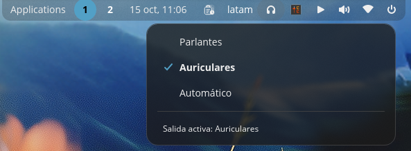

# cosmic-ext-applet-audio-switch

A COSMIC panel applet to select the analog audio output: **Parlantes** (speakers), **Auriculares** (headphones) or **Automático** (let the driver decide). It exists because on some HDA codecs the driver mutes the line-out by its own arbitration, so there is otherwise no way to say "play through the speakers even though headphones are plugged in".

## Saved mode

The mode you pick is saved to `$XDG_STATE_HOME/cosmic-ext-applet-audio-switch/mode` (or `~/.local/state/cosmic-ext-applet-audio-switch/mode` when `XDG_STATE_HOME` is unset) and re-applied when the panel starts, so a reboot comes back in the mode you last chose instead of the driver's boot-time state.

Only a mode the hardware actually accepted is saved — a failed apply leaves the previous value untouched. On startup the re-apply is retried for a few seconds, because the panel can start before the sound server has finished bringing the sink up. On a first run with no saved mode, nothing is written and the sound stack is not touched.

## Screenshots

## Why this applet exists (root cause)

In COSMIC (and many distributions with PipeWire + ALSA + HDA drivers), the `Auto-Mute Mode` control is only exposed on the real card mixer (`hw:N`), not on the virtual PulseWire/PipeWire mixer (`default`). Also, when multiple analog codecs are present, the correct card must be chosen (the one that actually drives the active sink). This applet:

- Discovers the active analog sink (using `pactl list sinks`), respecting the default sink when available.
- Reads which ALSA card backs that sink (`alsa.card`) to target the correct card mixer (avoids picking the wrong codec on multi-codec machines).
- Switches the sink port (`pactl set-sink-port`) and sets `Auto-Mute Mode` on the real card mixer.
- Carries the current volume level across a port switch. PipeWire keeps one volume per port, so without this the output would change level every time another port is forced.
- In `Automático` mode the port is left exactly where it is and only `Auto-Mute Mode` is handed back to the driver, so the applet never moves the output behind your back.
- Persists the last successful mode and restores it on startup (without touching hardware on first run if none is saved).

## Note on USB audio

This applet controls the **analog output of your system's sound card** (the 3.5mm line-out/headphone jacks handled by HDA/ALSA). It switches the analog sink port (`analog-output-lineout` / `analog-output-headphones`) and toggles `Auto-Mute Mode` on the real ALSA card that backs that sink.

It is not intended to control pure USB speakers/headsets in cases where:
- The device is a USB audio DAC/endpoint and appears as its own sink (separately selected in the sound settings), rather than being routed through the analog jack switching logic.
- Some speakers are only powered via USB but do not receive audio over USB (audio goes through another path). In that case, this applet has no effect on them, since it only targets the analog sink and its backing ALSA card.

The applet discovers the **active analog sink** via `pactl list sinks` and uses `alsa.card` from that sink to target the correct ALSA mixer. If your preferred output is a USB audio device, select it directly in COSMIC Sound settings instead.

## Popup notes

The applet popup closes with **Escape** only when it has focus. This was kept as-is to avoid changing existing behavior (see upstream `pop-os/cosmic-applets#509`).

## Shortcut

The applet registers `Super+Shift+A` by default to toggle/open the selector quickly. You can change it at any time in **COSMIC Settings → Keyboard → Custom shortcuts**.

### Default binding

The applet only registers this shortcut once. It records that it has already done so, so on later starts it **never re-adds** the shortcut and **never overrides** any change you made afterwards (not even if you changed the combination or removed it). If `Super+Shift+A` is already used by another shortcut, the applet leaves it alone. If the shortcuts file already contains a binding for this applet, it leaves the file untouched.

The registration is deliberately conservative: it keeps every other shortcut exactly as it was and only writes when the resulting RON is still valid.

## License

MIT — see [LICENSE](LICENSE).

---

# Español

Applet del panel de COSMIC para seleccionar la salida analógica de audio: **Parlantes**, **Auriculares** o **Automático** (dejar que el driver decida). Existe porque, en algunos codecs HDA, el driver silencia la salida de línea por su propia lógica de arbitraje y, de otro modo, no hay forma de decir «reproducir por los parlantes aunque haya auriculares conectados».

## Modo guardado

El applet recuerda el último modo aplicado. Guarda el modo **solo después** de aplicarlo correctamente y, al iniciarse, lo restaura (intenta hasta 25 veces con 400 ms de espera entre intentos) porque el panel puede arrancar antes de que PipeWire/WirePlumber haya recreado el sink analógico. **No toca el hardware en el primer arranque** si no hay ningún modo guardado previamente.

## Capturas de pantalla

## ¿Por qué existe este applet? (causa raíz)

En COSMIC (y en muchas distribuciones con PipeWire + ALSA + controladores HDA), el control `Auto-Mute Mode` solo está expuesto en el mezclador real de la tarjeta (`hw:N`), no en el mezclador virtual de PulseAudio/PipeWire (`default`). Además, cuando hay varios codecs analógicos, es necesario elegir la tarjeta correcta (la que realmente reproduce el sink activo).

Este applet:

- Descubre el sink analógico activo (con `pactl list sinks`), respetando el sink por defecto cuando está disponible.
- Lee qué tarjeta ALSA usa ese sink (`alsa.card`) para apuntar al mezclador correcto (evita elegir el codec equivocado en máquinas con varios codecs analógicos).
- Cambia el puerto del sink (`pactl set-sink-port`) y ajusta `Auto-Mute Mode` en el mezclador de la tarjeta real.
- Conserva el nivel de volumen al cambiar de puerto. PipeWire guarda un volumen por puerto, así que sin esto la salida cambiaría de nivel cada vez que se fuerza otro puerto.
- En el modo `Automático` el puerto queda exactamente donde está y solo se le devuelve `Auto-Mute Mode` al driver, de modo que el applet nunca mueve la salida a tus espaldas.
- Guarda el último modo elegido y lo restaura al iniciar, sin tocar el hardware en el primer arranque si no hay un modo guardado previamente.

## Nota sobre audio USB

Este applet controla **únicamente la salida analógica de la tarjeta de sonido** (los conectores jack 3.5mm line-out/auriculares gestionados por HDA/ALSA). Cambia el puerto del sink analógico (`analog-output-lineout` / `analog-output-headphones`) y ajusta `Auto-Mute Mode` en el mezclador ALSA real de esa tarjeta.

No está pensado para controlar altavoces/auriculares USB cuando:
- El dispositivo USB es un DAC/endpoint de audio que aparece como su propio sink (seleccionable directamente en los ajustes de sonido de COSMIC), en lugar de pasar por el cambio de puerto analógico.
- Algunos altavoces solo reciben alimentación por USB pero no transmiten audio por ese canal (el audio va por otro medio). En ese caso, el applet no tiene efecto sobre ellos, ya que no detecta ese dispositivo como un sink analógico sobre el que actuar.

El applet descubre el **sink analógico activo** con `pactl list sinks` y usa `alsa.card` de ese sink para apuntar al mezclador ALSA correcto. Si tu salida preferida es un dispositivo de audio USB, selecciónalo directamente en Ajustes de sonido de COSMIC.

## Notas sobre el popup

El popup del applet cierra con **Escape** solo cuando tiene el foco. Esta elección se mantuvo para no alterar el comportamiento existente (ver `pop-os/cosmic-applets#509` en upstream).

## Atajo de teclado

El applet registra `Super+Shift+A` por defecto para abrir/cerrar el selector rápidamente. Puedes cambiarlo en cualquier momento en **Ajustes del sistema → Teclado → Atajos personalizados**.

### Vinculación por defecto

El applet solo hace este registro una vez. Guarda que ya registró el atajo, por lo que en posteriores inicios **no lo vuelve a añadir** y **nunca sobrescribe** ningún cambio que hayas hecho (ni si cambiaste la combinación, ni si lo eliminaste). Si `Super+Shift+A` ya está en uso por otro atajo, el applet no lo toca. Si el archivo de atajos ya contiene un binding para este applet, tampoco lo modifica.

El registro es deliberadamente conservador: mantiene todos los demás atajos tal como estaban y solo escribe cuando el resultado sigue siendo un RON válido.

## Licencia

MIT — ver [LICENSE](LICENSE).
